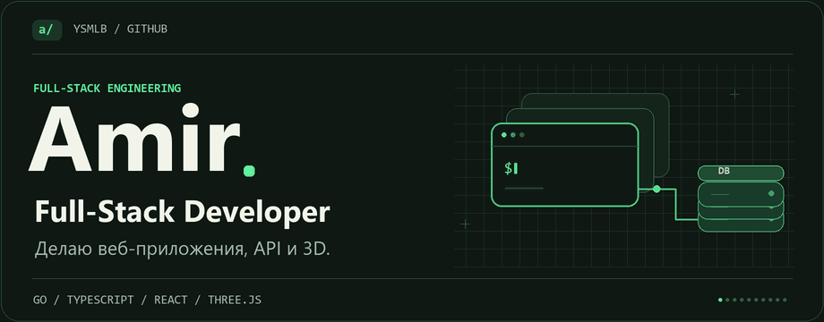
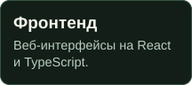
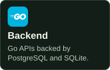
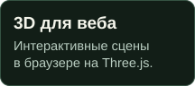
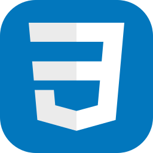
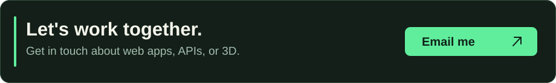

  <picture>
    <source media="(prefers-reduced-motion: reduce)" srcset="./assets/hero-fullstack-static.png">
    
  </picture>

<strong>Открыт к full-stack вакансиям</strong>

  
  

<h2 align="center">Что я делаю</h2>

  
  
  

<h2 align="center">Стек и инструменты</h2>

<strong>Языки</strong>

  
  
  
  
  

<strong>Фронтенд и 3D</strong>

  
  
  
  

<strong>Данные и инфраструктура</strong>

  
  
  
  
  

<h2 align="center">На что обращаю внимание</h2>

  
  

 

  

  <a href="mailto:amirisaga4@gmail.com">amirisaga4@gmail.com</a>
  &nbsp;·&nbsp;
  <a href="https://t.me/JAPYSM">@JAPYSM</a>

