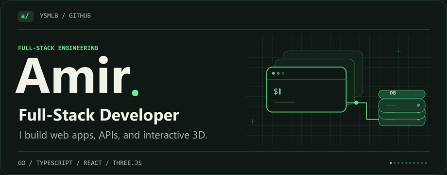
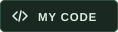
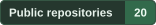
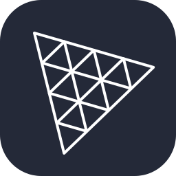
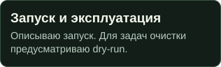

  <picture>
    <source media="(prefers-reduced-motion: reduce)" srcset="./assets/hero-en-static.png">
    
  </picture>

  
  
  

<strong>GitHub Activity</strong>

  
  

GitHub snapshot · November 25, 2026

<h2 align="center">What I Build</h2>

  
  
  

<h2 align="center">Stack &amp; Tools</h2>

<strong>Languages</strong>

  
  
  
  
  

<strong>Frontend &amp; 3D</strong>

  
  
  
  

<strong>Data &amp; Infrastructure</strong>

  
  
  
  
  

<h2 align="center">How I Work</h2>

  
  

 

  

  <a href="mailto:amirisaga4@gmail.com">amirisaga4@gmail.com</a>
  &nbsp;·&nbsp;
  <a href="https://t.me/JAPYSM">@JAPYSM</a>

