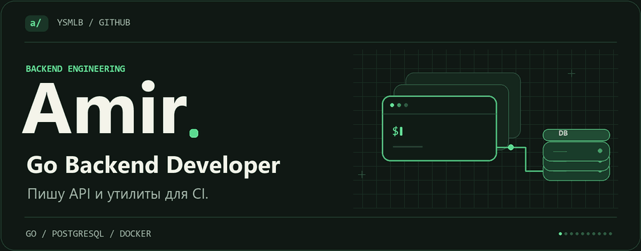
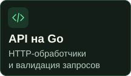
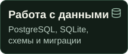
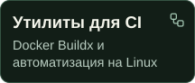

  <picture>
    <source media="(prefers-reduced-motion: reduce)" srcset="./assets/hero-static.png">
    
  </picture>

<strong>Открыт к предложениям на позицию Go Backend Developer</strong>

  
  
  

<h2 align="center">Что я делаю</h2>

  
  
  

<h2 align="center">Инструменты</h2>

<strong>Бэкенд и данные</strong>

  
  
  

<strong>Разработка и запуск</strong>

  
  
  

<h2 align="center">На что обращаю внимание</h2>

  
  

 

  

  <a href="mailto:amirsaga4@gmail.com">amirsaga4@gmail.com</a>
  &nbsp;·&nbsp;
  <a href="https://t.me/JAPYSM_vey">@JAPYSM_vey</a>

